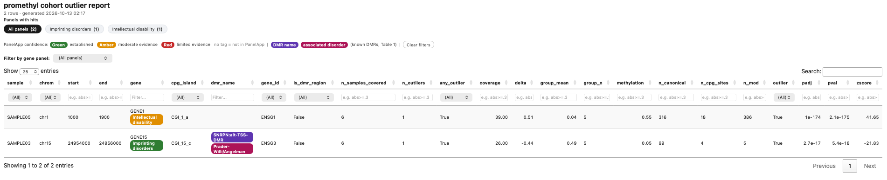

# promethyl

CpG methylation analysis pipeline for PacBio HiFi long-read sequencing data. Runs `modkit pileup` on haplotagged BAMs (hg38), aggregates methylation to CpG islands, annotates against gene promoters, and tests for differential methylation — either within a trio (proband/father/mother) or across a cohort (outlier detection).

## Quick start

Cohort outlier analysis on an HPC (Nextflow + Slurm), from BAMs to an HTML report:

```bash
# 1. one-time: environments (see Requirements / Nextflow sections for details)
export PROMETHYL_HOME=/path/to/promethyl
conda env create -f $PROMETHYL_HOME/promethyl_environment.yml        -p $PROMETHYL_HOME/envs/promethyl
conda env create -f $PROMETHYL_HOME/promethyl_report_environment.yml -p $PROMETHYL_HOME/envs/report

# 2. one-time: promoter annotation + (optional) PanelApp cache
python src/annotate_promoter_cpgs.py
python src/panelapp.py --cache panelapp_cache.json

# 3. describe your cohort (see cohort.yaml below), then run
export PATH="$PROMETHYL_HOME/bin:$PATH"
promethyl --samples cohort.yaml --outdir results
```

Outputs land in `results/`:

| File | Contents |
|---|---|
| `cohort_methylation.tsv` | Long-form island × sample table with z-scores, p-values and outlier calls ([column descriptions](#output-columns)) |
| `report.html` | Sortable/filterable outliers-only report ([example](#html-report-example)) |
| `panelapp_cache.json` | PanelApp lookups used by the report |
| `modkit/<sample>_modkit.bed` | Per-sample bedMethyl from `modkit pileup` |

A small synthetic example of the cohort TSV is in [`docs/example_cohort_methylation.tsv`](docs/example_cohort_methylation.tsv) (6 samples, 5 islands, values are simulated — not patient data).

## Requirements

- Conda / mamba
- A reference genome FASTA (hg38), not included in this repo
- `bedtools` on your `PATH` (used when building the promoter annotation reference)

Create the environment:

```bash
conda env create -f promethyl_environment.yml
conda activate promethyl
```

Key pinned tools/packages: `modkit=0.6.3`, `pandas`, `numpy`, `scipy`, `pyranges`, `pyyaml`.

`promethyl_environment.yml` also includes `jinja2` and `requests`, which the PanelApp/HTML report add-ons ([below](#known-dmr-panelapp-gene-and-html-report-annotation-optional)) need. Under Nextflow the report step runs in its own small environment instead (`promethyl_report_environment.yml`, pandas/jinja2/requests only) — see [Parallel cohort mode](#parallel-cohort-mode-nextflow).

## One-time setup: build the CpG island / promoter annotation

Before running the pipeline, generate the annotation BED file that both pipeline modes rely on:

```bash
python src/annotate_promoter_cpgs.py
```

This intersects a GENCODE GTF (promoters defined as −2000/+500 bp around each transcript TSS) with a CpG islands BED using `bedtools intersect`, producing `CpGs_with_promoters.bed`.


## Usage

There are two ways to run `src/main.py`: **trio mode** and **cohort mode**.

### Option 1 — Trio mode

Compares a proband against both parents and calls differentially methylated CpG islands.

```bash
python src/main.py \
    --proband proband.bam \
    --father  father.bam \
    --mother  mother.bam \
    --modkit-dir  /data/modkit \
    --annotation  reference/CpGs_with_promoters.bed \
    --ref         /data/genome.fa \
    --output      trio_methylation.tsv \
    --threads 10
```

### Option 2 — Cohort mode

Builds a methylation matrix across many samples and flags outliers by z-score.

```bash
python src/main.py \
    --config sample.yml \
    --modkit-dir /data/modkit/ \
    --annotation reference/CpGs_with_promoters.bed \
    --ref /data/genome.fa \
    --output /output-dir/probands_modkit_cohort_methylation.tsv \
    --include-bed reference/CPGIslandsBED3.bed \
    --threads 10
```

`sample.yml` should list each sample's ID and BAM path:

```yaml
samples:
  - id: sample01
    bam: /data/bams/sample01.bam
  - id: sample02
    bam: /data/bams/sample02.bam
```

### Option 3 — Per-sample scripts directly (`run_sample.py` + `run_cohort.py`)

These are the two scripts `main.nf` actually wraps under the hood (see below) — phase 1 runs per sample, phase 2 merges them into a cohort. Useful to run by hand for a single sample, for debugging outside Nextflow, or on a scheduler without a Nextflow setup (e.g. plain SLURM `sbatch` per sample).

```bash
# Phase 1 — once per sample
python src/run_sample.py \
    --id sample01 --bam /data/bams/sample01.bam \
    --modkit-dir /data/modkit \
    --annotation reference/CpGs_with_promoters.bed \
    --output sample01.islands.tsv \
    --threads 10

# Phase 2 — once, across all samples' phase-1 output
python src/run_cohort.py \
    --samples sample01=sample01.islands.tsv sample02=sample02.islands.tsv \
    --annotation reference/CpGs_with_promoters.bed \
    --dmr-bed reference/known_DMRs.bed \
    --min-cpg-sites 3 \
    --output cohort_methylation.tsv
```

`--dmr-bed` and `--min-cpg-sites` (see [Known DMR, PanelApp, and HTML report annotation](#known-dmr-panelapp-gene-and-html-report-annotation-optional) below) work here too, or via `dmr_bed`/`min_cpg_sites` keys in `sample.yml` under Nextflow ([below](#parallel-cohort-mode-nextflow)).

### Convenience wrapper

`run_pipeline.sh` wraps cohort mode with repo-relative default paths:

```bash
./run_pipeline.sh sample.yml
```

Edit the `REF` variable near the top of the script to point at your local reference FASTA before running.

`modkit pileup` is skipped automatically for any sample whose bedMethyl output already exists in `--modkit-dir`, so reruns only reprocess new samples.

### Parallel cohort mode (Nextflow)

For cohort mode, `main.nf` parallelizes phase 1 (`modkit pileup` + island aggregation) across all samples, runs phase 2 (cross-sample outlier analysis) once all samples finish, then phase 3 renders the HTML report:

```bash
nextflow run main.nf --samples sample.yml --outdir results
```

Every pipeline setting other than `--outdir` and `--threads` (per-sample `modkit pileup` threads, still a CLI/`params` option) is read from top-level keys in `sample.yml` instead of `--flag`s:

```yaml
samples:
  - id: sample01
    bam: /data/bams/sample01.bam
  - id: sample02
    bam: /data/bams/sample02.bam

annotation:   reference/CpGs_with_promoters.bed   # required
ref:          /data/genome.fa                     # optional
include_bed:  reference/CPGIslandsBED3.bed         # optional
region:       chr1:1000000-1100000                 # optional
min_coverage: 10
mod_code:     m
min_delta:    0.3
z_threshold:  2.0
dmr_bed:       reference/known_DMRs.bed           # optional
min_cpg_sites: 3                                   # optional, default 1 (no-op)
panelapp_cache: /path/to/panelapp_cache.json       # optional; seeds the report's PanelApp tags
```

Add `tissue` and `sex` per sample to restrict each sample's comparison group to matching samples (on chrX the group is additionally matched on sex). A sample missing either value is left out of every comparison group, so it is neither tested nor used as a comparator:

```yaml
samples:
  - id: sample01
    bam: /data/bams/sample01.bam
    tissue: WB
    sex: female
```

When tissue/sex matching is used, the cohort-level `cohort_mean`/`cohort_std`/`cohort_median` columns are replaced by per-sample `group_mean`/`group_n` ([see below](#output-columns)).

`annotation` is required in the YAML; the rest fall back to the same defaults as `main.py` (shown above) when omitted.

Each sample runs as its own `MODKIT` process (so samples run concurrently, limited only by the executor's available resources), writing `results/modkit/<sample>_modkit.bed`. Once every sample's process completes, a single `COHORT` process merges their island-level outputs and writes `results/cohort_methylation.tsv`. A final `REPORT` process then renders `results/report.html` (outliers only) and writes `results/panelapp_cache.json`.

Before `modkit pileup`, each BAM is checked for a mix of reads with and without `MM`/`ML` tags (which can hang modkit); BAMs that need it are fixed automatically. BAMs must already be indexed (`.bai`/`.csi`) — the pipeline stops with the `samtools index` command to run if an index is missing.

Add `-resume` to a rerun to reuse completed tasks.

`nextflow.config` defines a `standard` profile (local executor, the default) and a `slurm` profile (`-profile slurm`) for running on a Slurm cluster.

Nextflow always uses a pre-built conda environment for process execution — it does not solve `promethyl_environment.yml` on the fly. By default it looks for the env at `envs/promethyl` under `$PROMETHYL_HOME` (falling back to the repo root if `PROMETHYL_HOME` isn't set), so build it there once:

```bash
conda env create -f promethyl_environment.yml -p "${PROMETHYL_HOME:-.}/envs/promethyl"
```

Override the location with `--conda_env /some/other/env` if you'd rather keep it elsewhere.

### Shared install / running batches from elsewhere

To install promethyl once in a shared location and run batches from other directories (e.g. per-cohort working directories on an HPC), rather than checking out the repo per batch:

1. **Check out the repo once** at a shared, read-only-by-convention path, e.g. `/shared/tools/promethyl`.

2. **Set `PROMETHYL_HOME` and pre-build the conda environment there** (recommended on clusters where compute nodes lack channel/internet access):

   ```bash
   export PROMETHYL_HOME=/shared/tools/promethyl
   conda env create -f "$PROMETHYL_HOME/promethyl_environment.yml" -p "$PROMETHYL_HOME/envs/promethyl"
   ```

   `nextflow.config` reads `$PROMETHYL_HOME` at run time (via `System.getenv`), so as long as it's exported before `nextflow run`, the env at `$PROMETHYL_HOME/envs/promethyl` is picked up automatically — no `--conda_env` flag needed.

3. **Use the `bin/promethyl` wrapper** so batch directories don't need to know the full path to `main.nf`:

   ```bash
   export PATH="$PROMETHYL_HOME/bin:$PATH"

   cd /data/cohorts/my-batch
   promethyl --samples cohort.yaml -profile slurm
   ```

   `promethyl` just runs `nextflow run "$PROMETHYL_HOME/main.nf" "$@"` (adding `-profile slurm` automatically on Linux unless you pass `-profile` yourself); Nextflow's `work/` directory and outputs still land in the current directory (the batch dir), only the pipeline code and env are shared. Put the `export PROMETHYL_HOME=...` and `export PATH=...` lines in a module file or shared shell profile so users don't set them by hand each time.

## Pipeline overview

1. **`run_modkit.py`** — runs `modkit pileup` per sample (skipped if cached output exists)
2. **`bedmethyl.py`** — parses bedMethyl output, filters by coverage and modification code (`m` = 5mC, `h` = 5hmC)
3. **`CpG_meth.py`** — aggregates site-level calls to CpG islands and annotates with overlapping genes/promoters
4. **`merge_trio.py`** — merges proband/father/mother methylation for trio mode
5. **`cohort.py`** — builds the cross-sample matrix and detects per-sample outliers by z-score (cohort mode)
6. **`annotate.py`** — attaches gene/promoter annotation to results, and (optional) known-DMR annotation via `--dmr-bed`
7. **`statistics.py`** — trio-mode significance testing (Fisher's exact / chi-squared) with Benjamini–Hochberg FDR correction
8. **`panelapp.py`** — (optional) annotates genes against PanelApp panel membership/confidence, locally cached
9. **`generate_report.py`** — renders a cohort TSV as a sortable/searchable HTML report (run automatically as the `REPORT` step under Nextflow)

## Key CLI options

| Flag | Description | Default |
|---|---|---|
| `--min-coverage` | Minimum read coverage per CpG site | `10` |
| `--mod-code` | Modification code to test (`m`=5mC, `h`=5hmC) | `m` |
| `--min-delta` | Minimum absolute methylation difference (proband vs. parent mean) | `0.3` |
| `--fdr` | FDR significance threshold (trio mode) | `0.01` |
| `--z-threshold` | Z-score threshold for outlier calling (cohort mode) | `2.0` |
| `--min-cpg-sites` | Minimum CG positions backing a sample's own island call for it to be outlier-eligible (cohort mode, `run_cohort.py` only — see [below](#known-dmr-panelapp-gene-and-html-report-annotation-optional)) | `1` (no-op) |
| `--dmr-bed` | Known-DMR reference BED; tags overlapping islands with `dmr_name`/`disorder` (cohort mode, `run_cohort.py` only) | — |
| `--region` | Restrict `modkit pileup` to a genomic region (e.g. `chr1:1000000-1100000`) | — |
| `--include-bed` | Restrict `modkit pileup` to regions in a BED file | — |
| `--threads` | Threads for `modkit pileup` | `10` |

## Output

Trio mode writes one row per CpG island (wide form), with per-sample methylation/coverage columns and significance test results.

Cohort mode (`main.py --config`, `main.nf`, and `run_sample.py`/`run_cohort.py`) writes long-form output: one row per (CpG island, sample), sorted by `chrom`, `start`, `end`, `sample`. Locus and island-level columns repeat across each island's sample rows; per-sample metrics are plain columns.

### Output columns

Cohort TSV (`cohort_methylation.tsv`):

| Column | Description |
|---|---|
| `chrom`, `start`, `end` | CpG island coordinates (hg38). For known-DMR rows, the DMR's own boundaries |
| `cpg_island` | CpG island ID (the DMR name on known-DMR rows) |
| `is_dmr_region` | `True` for rows aggregated on a known DMR's exact boundaries (only with `--dmr-bed`); `False` for ordinary CpG islands |
| `n_samples_covered` | Number of samples with data at this island after the coverage filter |
| `n_outliers` | Number of samples flagged as outliers at this island |
| `any_outlier` | `True` if `n_outliers` > 0 |
| `gene` | Gene symbol(s) whose promoter overlaps the island (`;`-joined) |
| `transcript` | Transcript ID(s) for the overlapping promoter(s) (`;`-joined) |
| `gene_id` | Ensembl gene ID(s) (`;`-joined) |
| `dmr_name`, `disorder` | Known DMR(s) overlapping the island and the associated disorder(s) (`;`-joined, positionally paired). Only with `--dmr-bed` |
| `cohort_mean`, `cohort_std`, `cohort_median` | Mean / SD / median methylation across all samples at this island. Only when no tissue/sex metadata is supplied |
| `sample` | Sample ID for this row |
| `methylation` | Island methylation fraction for this sample: `n_mod / (n_mod + n_canonical)` |
| `n_mod`, `n_canonical` | Modified and canonical base counts summed over the island's CpG sites that passed `--min-coverage` |
| `coverage` | Mean per-site read coverage across the island's surviving CpG sites |
| `n_cpg_sites` | Number of individual CG positions summed into this island call. Low values mean a call rests on very few sites — see `--min-cpg-sites` |
| `group_mean` | Mean methylation of this sample's comparison group at this island (the other samples, matched on tissue and, on chrX, sex). Only with tissue/sex metadata |
| `group_n` | Number of comparison-group samples with data at this island. Check before trusting a call from a small group. Only with tissue/sex metadata |
| `delta` | `methylation` minus the group (or cohort) mean |
| `zscore` | `delta` divided by the group (or cohort) standard deviation |
| `outlier` | `True` if `abs(zscore)` ≥ `--z-threshold` **and** `abs(delta)` ≥ `--min-delta` **and** `n_cpg_sites` ≥ `--min-cpg-sites` |
| `pval` | Chi-squared test (no continuity correction) of this sample's `n_mod`/`n_canonical` against the pooled counts of its comparison group. `NaN` when no eligible comparison group exists (not tested, rather than not significant) |
| `padj` | Benjamini–Hochberg adjusted `pval`, corrected across all tested islands for that sample |

`outlier` is called from `zscore`, `delta` and `n_cpg_sites` only — `pval`/`padj` are reported alongside but are not part of the call.

### HTML report example

`generate_report.py` (run automatically as the last Nextflow step) turns the cohort TSV into a single sortable/searchable HTML file:



*Rendered from simulated data (see [`docs/example_cohort_methylation.tsv`](docs/example_cohort_methylation.tsv)).*

Report columns are the cohort TSV columns above, with these differences:

- `sample`, `chrom`, `start`, `end`, `gene`, `cpg_island`, `dmr_name`, `gene_id` are shown first, followed by the remaining columns in TSV order.
- `transcript` is dropped (`gene_id` covers it) and `disorder` is folded into the `dmr_name` cell rather than shown as its own column.
- `gene` cells are tagged with each gene's PanelApp panels, coloured by confidence: **Green** (established), **Amber** (moderate evidence), **Red** (limited evidence). No tag means the gene isn't in PanelApp.
- `dmr_name` cells show the known DMR (purple) and its associated disorder (pink).
- Outlier rows are shaded. `coverage`, `methylation`, `group_mean`, `delta` and `zscore` are shown to 2 decimal places and `pval`/`padj` to 2 significant figures; hover a cell for the full value.
- Every column has a filter box; numeric columns accept comparisons such as `>=0.3`, `abs>=0.3` (either sign) or `<0.01`. A panel dropdown and clickable panel summary filter rows by PanelApp panel, and **Clear filters** resets everything.

The report loads jQuery and DataTables from a CDN, so it needs internet access when opened in a browser.

## Known DMR, PanelApp gene, and HTML report annotation (optional)

Three optional add-ons, independent of each other and of the core pipeline — skip whichever you don't need.

**Known DMR tagging.** `reference/known_DMRs.bed` (chrom, start, end, dmr_name, disorder) is a curated list of imprinted/disease-associated DMRs. Pass `--dmr-bed reference/known_DMRs.bed` to `run_cohort.py` (see Option 3 above) to tag any island overlapping one — an island can overlap more than one DMR, in which case `dmr_name` and `disorder` are `;`-joined and stay positionally paired (i.e. `dmr_name.split(';')[i]` always corresponds to `disorder.split(';')[i]`, empty string where a DMR has no listed disorder).

**PanelApp gene annotation.** `src/panelapp.py` annotates gene symbols against [PanelApp Australia](https://panelapp-aus.org)'s panel membership and confidence level (Green/Amber/Red), for the HTML report's gene tags. Populate the local cache once with a full bulk download, rather than one live request per gene:

```bash
python src/panelapp.py --cache panelapp_cache.json
```

Re-run occasionally (e.g. monthly) to pick up PanelApp updates — not needed on every pipeline run once populated.

**HTML report.** `src/generate_report.py` renders a cohort TSV (any of the three modes above) as a single sortable/searchable/filterable HTML file, with gene cells tagged by PanelApp confidence and DMR/disorder where applicable:

```bash
python src/generate_report.py \
    --input cohort_methylation.tsv \
    --output report.html \
    --panelapp-cache panelapp_cache.json \
    --outliers-only
```

`--outliers-only` restricts the report to rows where `outlier`/`any_outlier` is `TRUE`; omit it to include every row.

## Notes

- Outputs, BAMs, and TSV files are git-ignored — regenerate them locally rather than committing.
- `*.bed` is also git-ignored by default (it's meant to catch pipeline-output BEDs), but the curated reference files under `reference/` (`CPGIslandsBED3.bed`, `CpGs_with_promoters.bed`, `known_DMRs.bed`, etc.) are deliberately force-added past that rule and are tracked. If you add a new reference `.bed` file, it needs `git add -f` explicitly or it will silently stay untracked.
- `--modkit-dir`, BAMs, and the reference FASTA are expected to live outside the repo.
